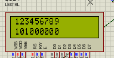
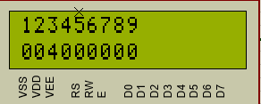

# Distributed Electronic Voting Machine Network

A multi-microcontroller distributed voting network implemented in Proteus using 5 Arduino boards (1 Master coordinator and 4 Slave voting terminals). The system integrates heterogeneous communication protocols (**SPI**, **$\text{I}^2\text{C}$ / TWI**, and **UART**), external non-volatile **EEPROM** storage, 4x4 matrix keypads, LM016L LCD displays, buzzer tones, and status LEDs.

---

## 🏗️ System Architecture & Hardware Setup

- **Master Controller:** Coordinates voting rounds, broadcasts ballot questions, receives ballots from voting stations, computes real-time tally aggregations, and commits final election results to an external non-volatile EEPROM chip.
- **Slave Voting Terminals (x4):** Dedicated voter kiosks equipped with:
  - **4x4 Matrix Keypad:** User input for selecting options (`0`–`9`), casting ballots (`+` then `=`), or retracting ballots (`-` then `=`).
  - **LM016L 16x2 Character LCD:** Displays active questions, candidate options (`123456789`), and vote status.
  - **Multicolor LEDs & Audio Buzzer:** Distinct acoustic and visual feedback confirming ballot submission vs. retraction.
- **Hardware Pushbutton Controls:**
  - **Pin 2 Button:** Displays the aggregated election result screen on the LCD.
  - **Pin 5 Button:** Commits the current vote tallies into EEPROM non-volatile memory.
  - **Pin 6 Button:** Resets and clears the election tally registers.

---

## 🗳️ Voting Modes & LCD Output

### Mode 0: Multi-Selection Ballot
Allows voters to select multiple choices from options `0` to `9`. For example, voting for options `1` and `3` displays:

  

### Mode 1: Single-Choice Ballot
Restricts each voter to exactly one choice among options `0` to `9`. For example, voting for option `3` displays:

  

### Mode 6: Single-Choice Ballot with Audio-Visual Confirmation
Restricts each voter to one option while activating designated buzzer audio tones and lighting status LEDs upon confirmation:

  

### Real-Time Vote Aggregation
Votes cast across all slave terminals are dynamically accumulated. For example, if multiple slave terminals cast votes for option `3`:

  

---

## 📡 Multi-Protocol Communication Scenarios

### Scenario 1: SPI Broadcast with UART Uplinks
- **SPI Broadcast:** The Master utilizes the SPI bus to broadcast ballot questions simultaneously to all slave terminals in a single transmission burst.
- **UART Return:** Each slave terminal uses dedicated UART serial channels to transmit individual ballots back to the Master coordinator.

### Scenario 2: Hybrid UART & $\text{I}^2\text{C}$ Architecture
- Three slave terminals communicate via UART, while the fourth slave communicates with the Master over the $\text{I}^2\text{C}$ bus alongside the external EEPROM memory.

### Scenario 3: Scalable $\text{I}^2\text{C}$ Multi-Drop Bus with SPI Arbitration
- Multiple slave terminals share the $\text{I}^2\text{C}$ serial bus.
- The Master uses SPI signaling to arbitrate bus access in a round-robin schedule, dynamically granting transmission rights and eliminating bus contention. This architecture allows scaling up to $2^7 - 1 = 127$ slave voting kiosks.

---

## 📄 گزارش پروژه نهایی ریزپردازنده (متن اصلی گزارش)

**نام:** مهدی آفریده  
**شماره دانشجویی:** ۹۷۳۱۱۳۱  

### مقدمه
در این آزمایش می‌خواهیم با استفاده از ۵ برد آردوینو (Arduino) دستگاه‌های ثبت رأی بسازیم؛ به‌گونه‌ای که چهار برد Slave برای یک برد Master، رأی‌هایی می‌فرستند (با توجه به سؤال و مدی که توسط Master تعیین شده و به آن‌ها فرستاده شده است)، و Master وظیفه دارد که رأی‌های دریافت‌شده را در یک حافظه EEPROM ذخیره کند.

### روند آزمایش
در ابتدا باید تعیین شود که از کدام Mode می‌خواهیم استفاده کنیم. در این پروژه سه مد پیاده‌سازی شده‌اند:
1. **Mode 0:** هر کاربر می‌تواند به هر یک از گزینه‌های ۰ تا ۹ رأی دهد. برای مثال اگر به گزینه‌های ۱ و ۳ رأی دهد، در صفحه Result (که با فشردن دکمه متصل به Pin 2 یا دکمه ۲ انجام می‌شود)، تصویر زیر دیده می‌شود:
   
   

2. **Mode 1:** هر کاربر می‌تواند فقط به یکی از گزینه‌های ۰ تا ۹ رأی دهد. برای مثال اگر به گزینه ۳ رأی دهد، در صفحه Result تصویر زیر دیده می‌شود:
   
   

3. **Mode 6:** هر کاربر می‌تواند فقط به یکی از گزینه‌های ۰ تا ۹ رأی دهد، که همراه با به صدا درآمدن بازر و روشن شدن LED مربوطه است:
   
   

**تجمیع آرا:** توجه شود به‌خاطر اینکه چندین Slave می‌توانند به یک گزینه رأی دهند، در همه مدها رأی‌های آن‌ها با هم جمع می‌شود. برای مثال اگر چندین Slave به گزینه ۳ رأی دهند:

### نحوه عملکرد و رابط کاربری
ما عملاً دو مد کلی داریم: یکی مد صفر و دیگری مد غیر صفر. برای مثال Master می‌تواند Mode را از حافظه بخواند یا با کیبورد به آن داده شود.

هر کاربر از یک کیبورد 4x4 استفاده می‌کند که به‌وسیله آن گزینه موردنظر را مشخص کرده و با زدن دکمه `+` و سپس برای تأیید `=`، به آن گزینه رأی می‌دهد. همچنین می‌تواند با مشخص کردن گزینه‌ای که قبلاً انتخاب شده و زدن دکمه `-` و سپس تأیید `=`، رأی خود را پس بگیرد. هنگام هر یک از این عملیات، بازرهایی با صداهای متفاوت و LEDهایی با رنگ‌های مختلف فعال می‌شوند.
- برای ذخیره‌سازی اطلاعات به‌دست‌آمده از رأی، از دکمه متصل به **Pin 5** استفاده می‌شود.
- برای Reset کردن اطلاعات، از دکمه متصل به **Pin 6** استفاده می‌شود.

### سناریوهای ارتباطی
1. **سناریو اول:** فقط از **SPI** برای فرستادن سؤال‌ها به دستگاه‌های رأی‌دهی (هنگام روشن شدن) و از **UART** برای ارتباط چهار برد Slave با Master استفاده شد. مزیت SPI این است که نیازی به برقراری ارتباط جداگانه با تک‌تک Slaveها نیست و سؤال‌ها در یک Transmission به همه ارسال می‌شوند.
2. **سناریو دوم:** از **$\text{I}^2\text{C}$** برای ارتباط با یکی از بردهای Slave (علاوه بر ارتباط با EEPROM) استفاده می‌شود.
3. **سناریو سوم:** از **$\text{I}^2\text{C}$** برای ارتباط با ۲ تا از بردها استفاده شده و از **SPI** برای سیگنال‌دهی نوبت استفاده می‌شود تا مشخص شود در هر لحظه باس دست کدام دستگاه است. این سناریو قابلیت تعمیم به تعداد زیادی از بردهای Slave را دارد (فراتر از محدودیت ۴ برد).

کد مربوط به هر یک از Slaveها مانند ماشین‌حساب است با این تفاوت که به‌جای محاسبه، داده ارسال می‌کند. در کد Master، با توجه به سناریوها، ۴ کیس وجود دارد که به‌صورت Round-Robin باس ارتباطی را به نوبت در اختیار بوردها قرار می‌دهد.
