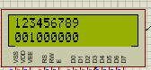

# Distributed Electronic Voting Machine Network

A multi-microcontroller embedded voting network implemented and simulated in Proteus using 5 Arduino nodes (1 central Master coordinator and 4 Slave voting terminals). The system integrates heterogeneous communication protocols (**SPI**, **$\text{I}^2\text{C}$ / TWI**, and **UART**), external non-volatile **EEPROM** storage, 4x4 matrix keypads, LM016L LCD displays, buzzer audio indicators, and status LEDs.

---

## 🏗️ System Architecture & Hardware Components

The network architecture divides responsibilities between a central coordinator and distributed kiosks:

- **Central Master Coordinator:**
  - Broadcasts ballot queries and voting configuration modes to all client kiosks.
  - Collects cast votes across multiple peripheral buses using round-robin token arbitration.
  - Aggregates vote totals in real time across all candidate options.
  - Commits verified election results to external non-volatile **EEPROM** for permanent tally persistence.
- **Distributed Slave Voting Terminals (x4):**
  - Dedicated user-facing voting kiosks equipped with a **4x4 Matrix Keypad** and an **LM016L 16x2 Character LCD**.
  - Provide immediate visual and acoustic feedback using dedicated buzzers and multicolored LEDs.
  - Maintain a stateless memory model—submitting ballots immediately to the central coordinator upon confirmation.

### Hardware Control Pushbuttons (Master Node)
- **Pin 2 (Result Display):** Triggers the central LM016L LCD to display the cumulative election results across all candidate options.
- **Pin 5 (EEPROM Save):** Commits the current in-memory election tallies into non-volatile EEPROM storage, safeguarding against power failure.
- **Pin 6 (Tally Reset):** Clears the running election tallies and resets all candidate registers to zero.

---

## 🗳️ Voting Modes & LCD Output

The system supports multiple configurable ballot modes configured via the Master controller or memory registers:

### Mode 0: Multi-Option Ballot
Enables voters to cast ballots for multiple candidate options (`0` through `9`). For example, selecting options `1` and `3` renders the following result output on the terminal LCD:

<p align="center">
  
</p>

### Mode 1: Single-Choice Ballot
Restricts each voter to exactly one choice among options `0` through `9`. For example, selecting option `3` renders:

<p align="center">
  
</p>

### Mode 6: Single-Choice Ballot with Audio-Visual Confirmation
Restricts each voter to a single option, while activating designated buzzer tone frequencies and illuminating indicator LEDs upon confirmation:

<p align="center">
  
</p>

### Real-Time Cross-Terminal Vote Aggregation
Votes cast across all slave terminals are dynamically accumulated. For example, when multiple slave kiosks cast votes for option `3`, the running sum updates in real time:

<p align="center">
  
</p>

---

## ⌨️ User Interaction & Keypad Interface

Each voting kiosk provides an intuitive, fault-tolerant interface driven by a 4x4 matrix keypad:

1. **Option Selection:** The voter presses the numeric key (`0`–`9`) corresponding to their candidate of choice.
2. **Casting a Vote:** The voter presses `+` followed by `=` to confirm and submit the ballot.
3. **Retracting a Vote:** If a voter makes a mistake, they can select their previously chosen option, press `-`, and confirm with `=` to revoke their ballot.
4. **Multi-Sensory Feedback:**
   - **Buzzer:** Emits distinct audio frequencies to distinguish between a successful vote submission and a vote retraction.
   - **LEDs:** Visual status LEDs light up in different colors based on the action taken (submission vs. retraction).

---

## 📡 Multi-Protocol Communication Scenarios

The system implements three distinct bus topologies to evaluate protocol efficiency, wiring overhead, and scalability:

```
Scenario 1: SPI Broadcast + Dedicated UART Uplinks
┌──────────────┐          SPI Broadcast (Simultaneous Queries)          ┌──────────────┐
│ Master Board │ ───────────────────────────────────────────────────────►│ Slave Kiosks │
│              │ ◄───────────────────────────────────────────────────────│  (1 to 4)    │
└──────────────┘          UART Serial Uplinks (Individual Ballots)      └──────────────┘

Scenario 3: Scalable I2C Multi-Drop Bus with SPI Round-Robin Token Arbitration
┌──────────────┐               I2C Shared Data Bus                      ┌──────────────┐
│ Master Board │ ◄──────────────────────────────────────────────────────►│ Slave Kiosks │
│              │               SPI Token Arbitration Line               │ (Up to 127)  │
│              │ ───────────────────────────────────────────────────────►│              │
└──────────────┘                                                        └──────────────┘
```

### Scenario 1: SPI Broadcast with Dedicated UART Uplinks
- **Downlink (Master $\to$ Slaves):** The Master utilizes **SPI** to broadcast ballot questions and active modes to all kiosks simultaneously in a single bus cycle, eliminating redundant point-to-point messaging.
- **Uplink (Slaves $\to$ Master):** Each slave terminal utilizes a dedicated **UART** serial line to transmit individual cast ballots back to the Master coordinator.

### Scenario 2: Hybrid UART & $\text{I}^2\text{C}$ Architecture
- Three slave kiosks transmit ballots over dedicated UART lines.
- The fourth slave kiosk communicates over a shared **$\text{I}^2\text{C}$ / TWI** bus, coexisting with the external EEPROM memory chip.

### Scenario 3: Scalable $\text{I}^2\text{C}$ Multi-Drop Bus with SPI Token Arbitration
- Multiple slave terminals share a common two-wire $\text{I}^2\text{C}$ bus.
- To prevent transmission collisions without requiring multi-master complexity, the Master coordinator acts as a token arbiter via SPI control lines in a round-robin schedule.
- When granted the bus token, a terminal transmits its queued ballot data; if idle, it returns a zero acknowledgement.
- This architecture enables horizontal scaling across the standard 7-bit $\text{I}^2\text{C}$ address space (up to $2^7 - 1 = 127$ voting terminals).

---

## 💻 Simulation & Source Files

The repository includes complete firmware source code, pre-compiled Intel HEX binaries, and Proteus design schematics:

- **Proteus Schematics:**
  - `microlab final v8 serial and spi scenario1.pdsprj` (Scenario 1)
  - `microlab final v8 serial and spi and i2c scneario2.pdsprj` (Scenario 2)
  - `microlab final v8 serial and spi and i2c2 scenario3 .pdsprj` (Scenario 3)
- **Firmware Sources & Binaries:**
  - `triMasterUartWithSpi code.txt` / `.hex`: Master coordinator firmware.
  - `slaveUsart with spi.txt` / `.hex`: Slave terminal firmware for UART/SPI.
  - `masterI2Code.txt` / `masteri2c.hex`: Master $\text{I}^2\text{C}$ firmware.
  - `slavei2c code.txt` / `slavei2c.hex`: Slave $\text{I}^2\text{C}$ terminal firmware.
